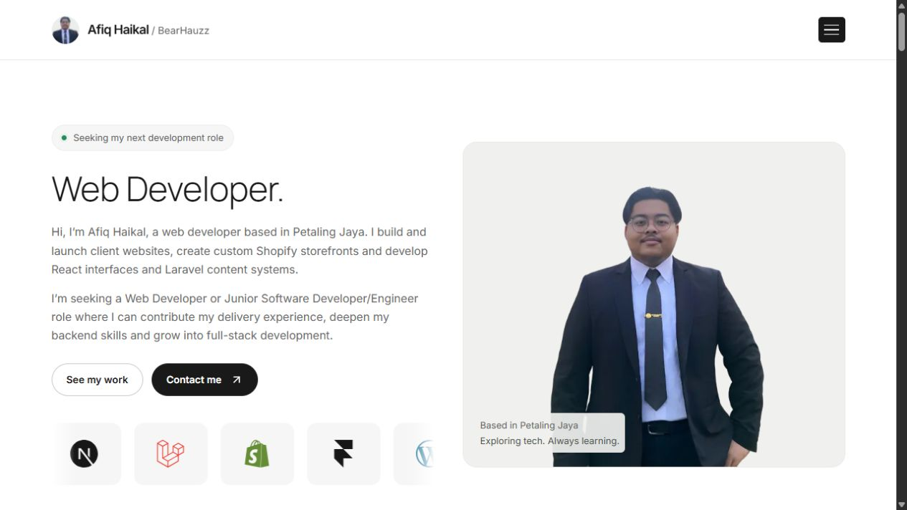
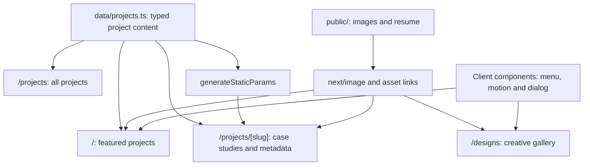
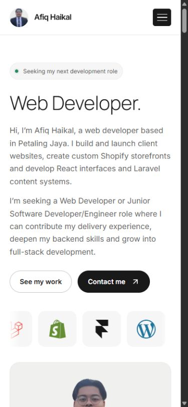
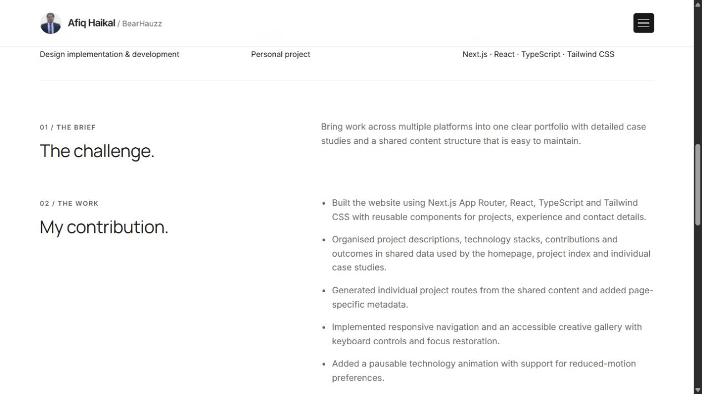

# BearHauzz Portfolio

Afiq Haikal's personal portfolio, built with Next.js App Router, React and TypeScript. It brings professional experience, project case studies and creative work into a responsive website, with shared project data used across the homepage, project index and detail pages.

**[View the live portfolio](https://bearhauzz-portfolio.vercel.app/)** · [Project index](https://bearhauzz-portfolio.vercel.app/projects) · [Creative work](https://bearhauzz-portfolio.vercel.app/designs)



## Features

- A homepage with skills, selected work, experience, working approach and contact links.
- Thirteen project case studies covering independent applications, personal, academic, client and previous-role work; six are featured on the homepage.
- Resume-aligned skill groups covering programming, frontend, backend, platforms, deployment and testing.
- Project pages with contribution summaries, technology stacks, outcomes and page-specific metadata.
- A six-item creative gallery with a native modal image viewer.
- A downloadable résumé, email and WhatsApp contact links and responsive navigation.

The seven GoViral Lab case studies record contributions and project status at the end of the contract on **9 October 2026**. Live sites, client review, unpublished themes and development previews retain distinct labels; the Janine thumbnail is a Framer design preview. Client source code is not included or assumed to be public.

The homepage and project index lead with BJBC, BearHauzz Portfolio, CampusSphere, MyPATH, VASTIQ Solutions and GoViral Lab. BJBC is an independent application in development with no published demo URL or screenshot supplied. Its text cover uses the existing fallback. All other projects remain available on the project index.

## Tech stack

Versions below are recorded in the committed lockfile.

| Area | Technology |
| --- | --- |
| Framework | Next.js **16.2.1**, App Router |
| UI | React and React DOM **19.2.4** |
| Language | TypeScript **5.9.3**, strict mode |
| Styling | Tailwind CSS **4.2.2** and custom CSS |
| Icons | react-icons **5.6.0** |
| Linting | ESLint **9.39.4** with Next.js and TypeScript rules |
| Hosting | Vercel |

## Architecture

Page components compose shared UI and local content. Small client components handle the navigation menu, technology animation, scroll reveals and creative gallery. Project content is maintained in a typed TypeScript module.



Project detail pages resolve a slug against the shared array, generate known project paths through `generateStaticParams`, and call `notFound()` for unknown entries. Contact actions use email and WhatsApp links. The reviewed repository has no API route handlers, database connection or CMS; Laravel, Shopify and other platforms appear as technologies used in the projects being presented.

## Project structure

| Path | Responsibility |
| --- | --- |
| [app/](app/) | Routes, shared layout, metadata, global styles and not-found page |
| [app/projects/](app/projects/) | Project index and individual case-study route |
| [app/designs/](app/designs/) | Creative-work page |
| [components/](components/) | Navigation, cards, gallery, experience, motion and contact UI |
| [data/projects.ts](data/projects.ts) | Typed project content and selection rules |
| [public/](public/) | Project/design images, profile assets and résumé |
| [scripts/generate_resume.py](scripts/generate_resume.py) | Optional PDF résumé generator |
| [docs/MAINTENANCE.md](docs/MAINTENANCE.md) | Content, asset and deployment maintenance |

## Getting started

Use Node.js **20.9.0 or newer**, the minimum declared by the locked Next.js package, and npm. A fresh build may need network access to download the Google fonts configured through `next/font`.

```bash
git clone https://github.com/BearSoleh/bearhauzz-portfolio.git
cd bearhauzz-portfolio
npm ci
npm run dev
```

Open [localhost:3000](http://localhost:3000). The reviewed source reads no environment variables, so a local `.env` file is not needed for the current portfolio.

To check and serve a production build:

```bash
npm run lint
npm run build
npm start
```

| Script | Purpose |
| --- | --- |
| `npm run dev` | Start the Next.js development server |
| `npm run lint` | Run ESLint |
| `npm run build` | Create the production build |
| `npm start` | Serve an existing production build |

## Technical highlights

**Shared content across routes.** The same `Project` model and array drive cards, case studies and metadata. The homepage selects the portfolio plus the seven entries without an `agency` label; the index displays all twelve. The [maintenance guide](docs/MAINTENANCE.md#project-content-and-selection) explains this selection rule.

**Responsive media and layout.** Custom CSS adjusts grids, typography and spacing at 700px and 900px breakpoints. Images use `next/image` with responsive sizing; WebP copies reduce the transfer size of client and creative thumbnails. Inter and Manrope are configured with `next/font/google` and self-hosted by Next.js after download.

**Keyboard and motion support.** The site includes a skip link, visible focus styles, labelled menu controls, Escape handling and focus restoration. The gallery uses `<dialog>`; experience entries use `<details>`. The technology strip can be paused, and motion effects respect reduced-motion preferences.

The light layout and typography follow the Fastfolio reference, adapted to Afiq's projects and experience.

## Screenshots

These unedited captures show the live portfolio on **29 October 2026**. They document the deployed site at capture time.

<details>
<summary>Mobile homepage and project case study</summary>

### Mobile homepage



### Project case study



</details>

## Deployment and maintenance

Production: **[bearhauzz-portfolio.vercel.app](https://bearhauzz-portfolio.vercel.app/)**.

The existing project documentation records automatic Vercel deployments from `main`. The commit reviewed for this documentation update, `406ef5f`, has a successful Vercel deployment status. Confirm the linked repository, production branch, Node version and build settings in the Vercel project before changing deployment configuration.

For content updates, screenshot paths, optional résumé generation and deployment checks, see [Maintenance](docs/MAINTENANCE.md).

During this review, the live homepage, portfolio case study and gallery loaded; mobile menu and gallery Escape/focus behavior were checked. Local lint/build commands were not rerun. No automated test script or tracked CI workflow is present, and the browser checks do not constitute a complete accessibility or cross-browser audit.
